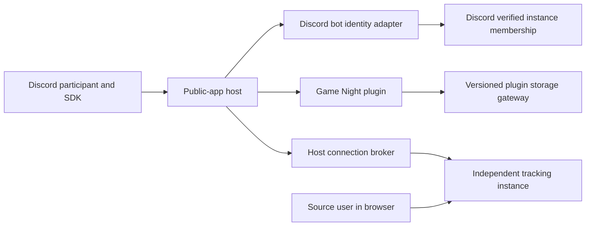
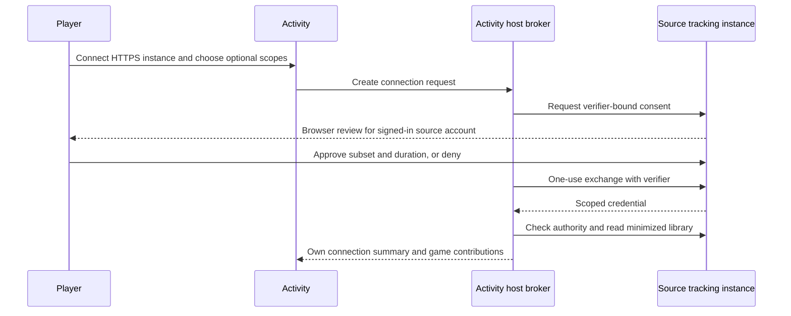
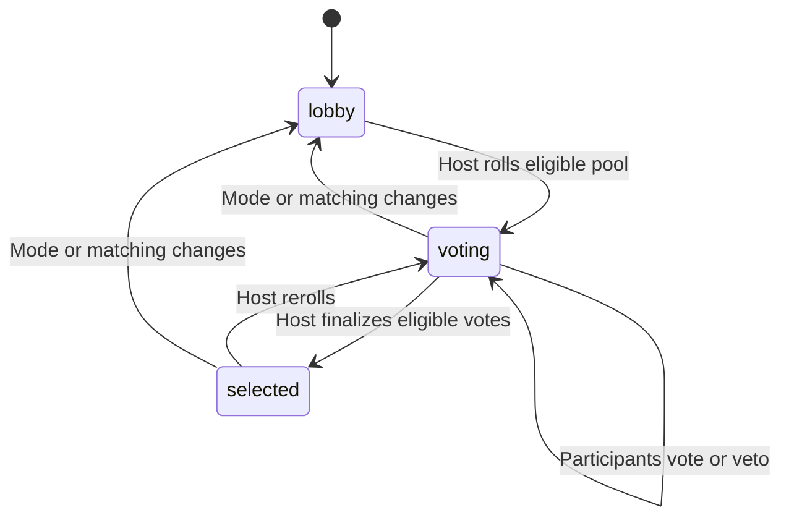

# Game Night architecture and acceptance

This describes the early signed Game Night release and coordinated Plugin API
1.1.12 host support, as of 18 October 2026.
It records the implemented design and remaining checks; it is not a claim that
every item in the umbrella issue is released. Start with the
[operator and player guide](../examples/discord-game-night.md) for setup.

## Repository ownership

| Concern | Implementation | Boundary |
| --- | --- | --- |
| Packaged Activity, personal rules, room state and selection | `official/discord-social-activity/plugin.py`, `engine.py`, `ui/` | Plugin repository; no host imports, database access or direct sockets |
| Discord OAuth, app identity, verified room membership and native invite settings | `official/discord-bot-notifications/plugin.py`, `native/app.js` | Existing bot adapter extended without replacing notification delivery |
| External actors, sessions, installation grants and packaged assets | Host `src/backend/src/plugin_api/public_apps.py`, `src/backend/src/api/routes/public_apps.py` | Host owns lifecycle and authorization |
| Consent, expiry, scopes, rotation and revocation | Host `src/backend/src/features/delegation.py`, `src/core/delegation.py`, `src/api/routes/delegation.py` | Source instance authenticates its own user |
| Encrypted connections, live source checks and minimized libraries | Host `src/backend/src/features/public_app_sources.py`, `legacy_integrations.py`, `delegated_library.py` | Host broker; credentials never enter Activity code |
| Safe HTTPS and artwork | Host `src/backend/src/plugin_api/outbound.py`, `src/features/public_catalogue.py` | Bounded requests, redirect/private-address protections |
| Native multiplayer editing | Host `src/frontend/src/components/game/GamePlayFields.vue`, `GamePlayPanel.vue`, `components/BulkEditModal.vue` | General library feature, not Discord-specific |
| Saved participant administration | Activity `native/`, `privacy.py`; host `src/backend/src/features/public_app_admin.py` | Explicit admin grant, installation scope, credential-free summaries; plugin scrubs its own rooms |

The host's [public-app contract and route matrix](https://github.com/obsoletelabs/unnamed_tracking_app_2/blob/feat/plugin-discord-activity-host/wiki/docs/development/plugin-public-apps.md)
lists the exact delegated operations and ordinary/admin API rejection behavior.
Core Steam/IGDB and other built-in metadata providers remain host features.

## Identity and authority

A Discord user is an external principal, scoped to this installed identity
provider. It is not a host account. The server verifies Discord user, application,
location and connected membership; browser-supplied names and room IDs confer no
authority. A tracking account is linked only through source consent or the
explicit legacy-key path. Matching display names do not link accounts.

The room host controls mode, matching, shortlist/final selection and deliberate
host transfer. Every participant controls their own games, preferences, vote and
vetoes. Any participant can supply missing room player counts or approve a game
for the current group. A room approval never edits someone else's source account.
Library data is minimized for group decisions; another participant's credentials,
private notes and administrator capabilities are not shared.

Source write operations enforce both ownership and their own capability:

| Capability | Effect |
| --- | --- |
| `profile.read`, `games.read` | Default connection; identity and own library reads |
| `achievements.read`, `tracking.write`, `achievements.write` | Optional progress features, separately reviewed on source |
| `compatibility.write` | Optional replacement/clearing of own multiplayer presets |

`tracking.write` does not imply `compatibility.write`. Existing grants must be
reauthorized to add it. Legacy API keys retain broad authority on their source,
but this broker permits only fixed identity/library reads and rejects writes.

## State and user flows

Room updates use public `storage.compare_and_swap` with bounded retries, so
simultaneous changes do not silently overwrite each other. Current access is
rechecked before roll/finalize; cached or stale source data cannot silently prove
current access. Personal vetoes and hard rules remain effective under every mode.
Strict requires all owners, Balanced at least half, and Discovery at least one.
Purchase consideration additionally requires each affected person's consent.
Prices are currently unavailable and price/budget/discount checks are paused.

| Screen | Main action | Recovery / disclosure |
| --- | --- | --- |
| Launch | Verified Discord sign-in | Configuration and membership errors; direct-browser explanation |
| Game night | Inspect eligible cards, shortlist, vote, select, veto/undo | Searchable paginated Needs attention list; inline counts/platform or bulk current-group approval |
| My games | Browse automatic owned multiplayer entries; add self-report | Search, ownership/multiplayer filters, selection across source instances; saved versus inferred metadata labels |
| My rules | Choose own platform, session/genre and ownership preferences | Hard rules shown in exclusion reasons; unavailable pricing explained |
| Connections | Scoped consent or acknowledged legacy key | State, scopes, expiry, last access check, refresh and disconnect |
| Tracking | Review and confirm own status or local achievement report | Scope checks; approval resets when target changes; provider evidence kept separate |
| Host settings | Mode, title/platform matching and inference policies | Transfer has a separate named-person confirmation dialog |

Missing player counts stay unknown. One/two-player multiplayer inference and
Steam-to-PC inference are labeled and can be disabled by the host. Explicit
platforms and known limits win. Current-group approval expires logically when
player count changes; it does not manufacture a reusable min/max range.

Room retention follows the operator's guest retention policy (1–8760 hours,
up to 365 days; changes apply to new rooms).
The plugin prunes expired room records; host cleanup handles expired actors and
sessions. An explicitly approved Until revoked source connection can outlive a
room and be reused by the same verified identity. Disconnect removes the broker
copy; source-side revoke invalidates the grant. The engine has a leave/clear
operation. The native administrator plugin page lists saved participants and
supports source unlink, participant purge and installation-wide purge, with a
separate critical permission and explicit confirmation. Self-service guest-data
deletion/profile controls remain in #39; verified retroactive linking is tracked
in [#45](https://github.com/obsoletelabs/unnamed_tracking_app_plugins/issues/45).

## Launch contexts and deployment

| Context | Preview status |
| --- | --- |
| Configured server text channel | Two-account launch/join tested |
| Configured server voice channel | Muted launch tested |
| Two-person DM | Two-account membership, shared selection and reconnect tested |
| Group DM | Implemented private-channel verification; separate live acceptance pending |
| Stage | Discord disabled Activity launch in the tested client; use text/voice/DM |
| Mobile | Responsive styles provided; device acceptance pending |

Each operator currently owns a Discord application and HTTPS Activity endpoint.
One operator can centrally host Game Night for independent source instances using
explicit consent. A single official application routing to arbitrary independent
Activity operators, federation and cross-operator rooms are not implemented.
The HTTPS broker uses public protocol routes rather than private network access.
Live room updates use polling; a Gateway/WebSocket service would be a separate
host capability, not a hidden socket in the sandboxed plugin.

Discord's official [Activity setup](https://docs.discord.com/developers/activities/building-an-activity)
and [user-installable application guide](https://docs.discord.com/developers/tutorials/developing-a-user-installable-app)
describe installation contexts. Private-channel command contexts and application
testing/visibility must permit the participant; plugin settings cannot override
Discord's launch restrictions.

## Issue coverage and release gates

| Issue | Implemented / covered by the paired PRs | Remaining |
| --- | --- | --- |
| [Host #119](https://github.com/obsoletelabs/unnamed_tracking_app_2/issues/119) | Generic delegated boundary, scopes, public sessions, broker, rejection/ownership tests, native consent UI | Whole ordinary-route audit beyond the integration matrix |
| [Host #120](https://github.com/obsoletelabs/unnamed_tracking_app_2/issues/120) | Platform-neutral contracts and UI | Non-Discord reference client/integration |
| [Plugin #28](https://github.com/obsoletelabs/unnamed_tracking_app_plugins/issues/28) | Existing bot extended for verified Activity identity; notifications preserved | Persistent online presence / notification profile linking remain separate |
| [#33](https://github.com/obsoletelabs/unnamed_tracking_app_plugins/issues/33) | Multiplayer Activity MVP implementation | Umbrella also includes later community/federation work; keep open |
| [#34](https://github.com/obsoletelabs/unnamed_tracking_app_plugins/issues/34) | Repository map, architecture/sequence/state diagrams, context and flow matrices here | Discovery deliverables complete |
| [#35](https://github.com/obsoletelabs/unnamed_tracking_app_plugins/issues/35) | Identity/roles, scopes, retention, isolation, concurrency and administrator purge contracts | Self-service deletion/profile in #39; account linking in #45 |
| [#36](https://github.com/obsoletelabs/unnamed_tracking_app_plugins/issues/36) | Independent shell, onboarding, guest/linked labels, reconnect and configuration | Full lifecycle acceptance on deployed installation |
| [#37](https://github.com/obsoletelabs/unnamed_tracking_app_plugins/issues/37) | Independent sources, provenance/access freshness, saved presets, reads and consented writes | Live independent-source outage test |
| [#38](https://github.com/obsoletelabs/unnamed_tracking_app_plugins/issues/38) | Three selection modes, personal hard rules, explainable exclusions/vetoes | Custom owner thresholds; pricing intentionally paused |
| [#39](https://github.com/obsoletelabs/unnamed_tracking_app_plugins/issues/39) | Hosted guest self-reports and retention; no host-account impersonation | Rich guest profile / early-delete UI and verified-only room policy |
| [#40](https://github.com/obsoletelabs/unnamed_tracking_app_plugins/issues/40) | Host-aligned styling, setup/player guides, screenshots and regression tests | Full narrow/mobile/focus/motion, GDM, source-outage and disable/uninstall acceptance; live provider override needs provider rows |
| [#41](https://github.com/obsoletelabs/unnamed_tracking_app_plugins/issues/41) | No persistent community product in MVP | Follow-up |
| [#42](https://github.com/obsoletelabs/unnamed_tracking_app_plugins/issues/42) | Independent source consent is not federation | Follow-up |
| [#43](https://github.com/obsoletelabs/unnamed_tracking_app_plugins/issues/43) | Public boundaries support future work | Follow-up extension contracts remain |
| [#45](https://github.com/obsoletelabs/unnamed_tracking_app_plugins/issues/45) | Administrator unlink/purge available | Verified retroactive account linking and conflict handling |
| [#46](https://github.com/obsoletelabs/unnamed_tracking_app_plugins/issues/46) | Optional presets, bulk editor, labeled inference and group approval | Deferred metadata and cross-instance bulk refinements |

Implementation PRs: [host #121](https://github.com/obsoletelabs/unnamed_tracking_app_2/pull/121)
and [plugins #44](https://github.com/obsoletelabs/unnamed_tracking_app_plugins/pull/44).
The early 0.1.0 release uses the registered official signer and catalogue, with
manual updates. The remaining live acceptance checks above stay open; signed
publication does not mark those checks or deferred features complete.
