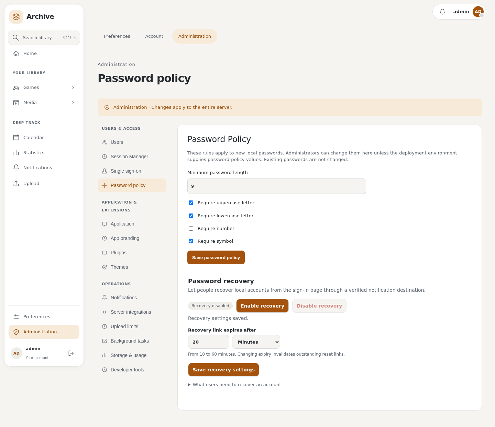
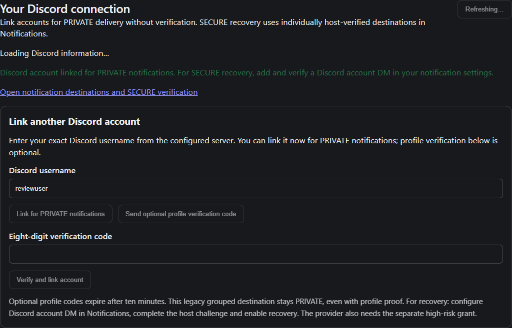
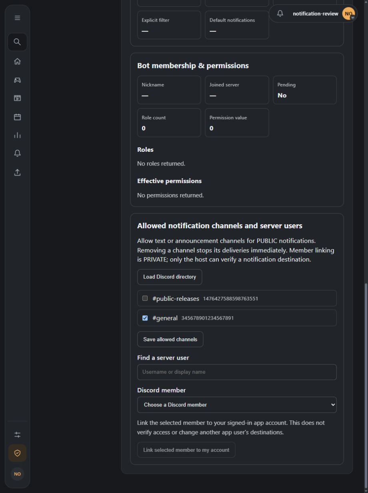
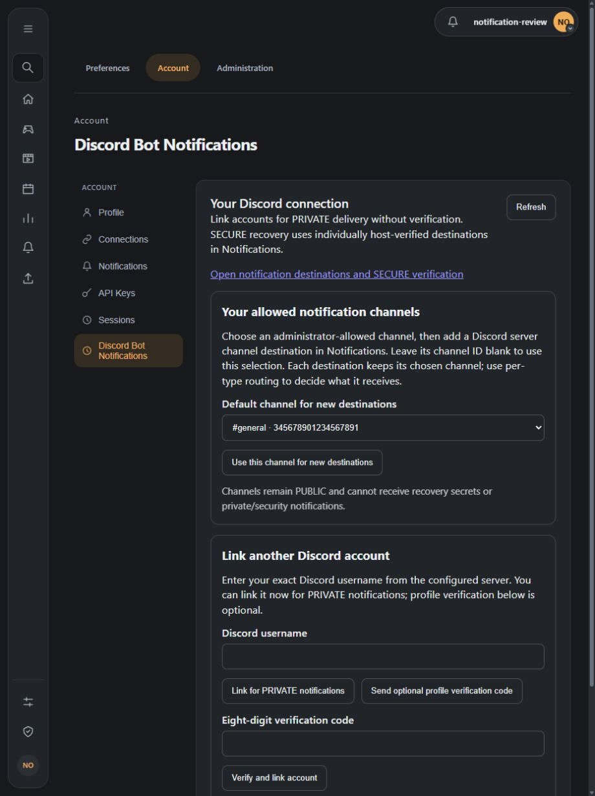
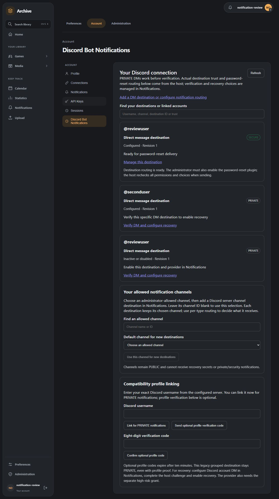
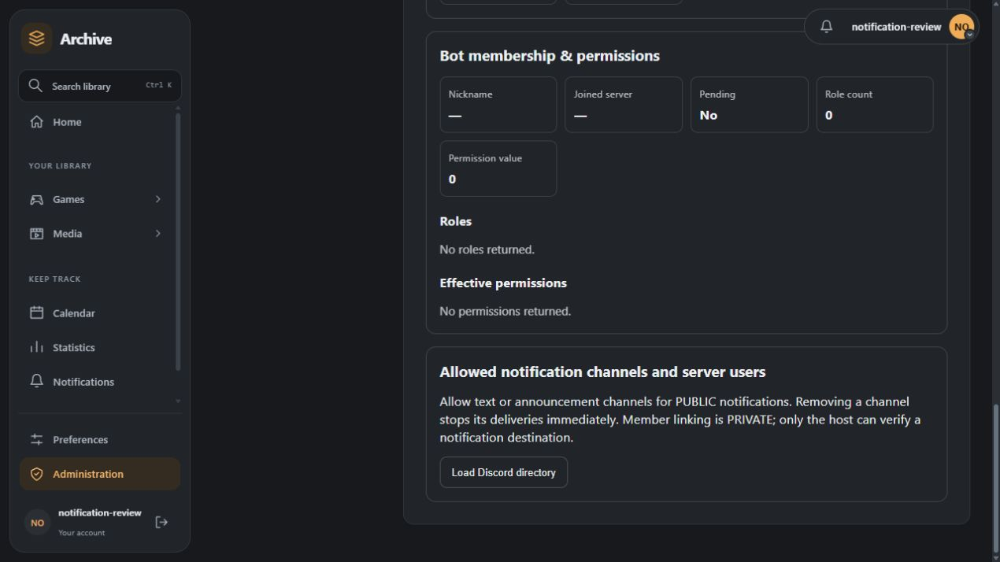

# Notifications: send one requested message

## Goal

Send a persistent host notification to the authenticated caller.

## Prerequisites

Declare `notifications.send` v1 and a permission rationale. Use a short declared
action; Recently Played Notifier demonstrates data-driven notification behavior.

## Minimal code

<!-- recipe: notifications -->
```python
from sdk.plugin_protocol import request

def run(values: dict) -> dict:
    return request("notifications.send", "notifications.send", {
        "title": "Report ready", "body": "Your requested report is available."
    })
```

The host owns records and delivery preferences. A local native toast is transient
browser feedback. External provider delivery is another contract, demonstrated
by Discord Notifications; do not copy host retry/deduplication infrastructure.

## Test command

```sh
python -m pytest tests/test_feature_tutorials.py -k notifications
python -m pytest tests/test_help_button.py -k notification
```

## Expected result

The exact message is sent through the public gateway. Denial raises an actionable
SDK error. In a configured development host, the user sees one host notification;
delivery preferences may determine the channel.

## Common mistakes

Sending a notification every time an unchanged event is polled; treating a toast
as durable delivery; leaking a secret or another user's data in the body; returning
success after a denied gateway call.

## Plugin-owned providers (API1.1.5)

The maintained `official/discord-notifications` consumer registers a PUBLIC webhook
using `transport="plugin"` and bounded configuration fields. The plugin stores its
credentials and owns HTTPS delivery through its declared network capability.
The core selects approved content, applies destination trust and per-webhook consent,
owns attempts/retries, and rechecks installation/grants/preferences before handoff.
PUBLIC webhooks cannot receive verification/security/recovery content.

The earlier `discord_webhook` protected-layout transport remains supported for
compatibility and the Chaos demo. Its host broker accepts approved field layouts
and keeps credentials outside plugin code. It is not the maintained webhook's
current transport. Existing credential/consent records are not transferred.

## Per-account possession proof (API1.1.6)

PRIVATE kinds declare `verification_supported`, `sensitive_supported` and
`recovery_supported`; declarations never assert SECURE trust. Core issues exact
destination/revision-bound ten-minute codes and verifies them itself. The independent
critical `notification_providers.sensitive` grant allows verification and approved
security/recovery content at handoff. Broad API/source/delivery grants do not imply it.
Plugins can read this content; explain this explicitly in permission review.
Recovery additionally requires a verified external destination and explicit user opt-in.

The maintained Discord bot declares an independent per-account provider with server and
username fields. PRIVATE delivery works before proof. Core UUID/revisions map to exactly
one Discord account, with no broadcast fallback. Its legacy grouped provider/native
dashboard remain PRIVATE and retain existing links. See the [bot migration guide](https://github.com/obsoletelabs/unnamed_tracking_app_plugins/blob/main/official/discord-bot-notifications/README.md).
The paired host is [PR71](https://github.com/obsoletelabs/unnamed_tracking_app_2/pull/71).

## Scoped lifecycle replay (Plugin API 1.1.4)

Declare at least host contract 1.1.4 and explicitly request `notifications.lifecycle.read` with a clear permission rationale before calling `sdk.notifications.poll_lifecycle(cursor, limit=100)`. Neither notification sending, provider delivery, `events.subscribe` nor `api.full` implies the read grant. Requests cannot select another user, installation, provider or destination.

Only the authenticated user/current installation's own source notification lifecycle and own provider delivery states appear. Events contain opaque event/notification/delivery IDs, UTC occurrence time and status. They contain no message bodies, destination IDs, endpoint addresses, credentials, error strings or recovery authority. A source does not receive other providers' delivery history. Revocation stops reads; reinstall needs renewed permission and cannot reclaim the previous installation's feed.

Responses contain `events`, `cursor`, `has_more` and `resync_required`. Process and deduplicate stable event UUIDs before saving the next opaque cursor. A null cursor begins retained history. When `resync_required` is true, discard stale local assumptions and restart using the returned cursor; expired history cannot be reconstructed. This is a change feed rather than a state snapshot. Core publication occurs through the existing job loop in bounded batches; backlog may span multiple ticks.

The host's server-configurable default is 90 days (`NOTIFICATION_AUDIT_RETENTION_DAYS`), independently of inbox retention and longer-lived dedupe receipts. The core owns ordering, audit persistence, leases and delivery retries. These exported schemas are compared with the paired host's public models by `tools/check_host_contract.py`; plugins import only the SDK. This extension depends on host PR [#47](https://github.com/obsoletelabs/unnamed_tracking_app_2/pull/47).

## Failure simulation

The signed Notification Chaos Demo exercises the same protected renderer without a second transport API. Its settings select reversed approved fields, a bounded persistent first-render failure, repeated failure or an intentionally invalid layout. Exceptions enter core retry handling; invalid layouts are rejected before network I/O. Its ledger stores only opaque notification IDs, never delivery rows or credentials. See [examples](../examples/index.md#notification-chaos-demo) and `tests/test_notification_chaos_provider.py`.


## Maintained password recovery (API 1.1.7)

The maintained `official.password-reset` plugin enables the host's reserved password-reset flow. It is separate from the synthetic routing demo. Installation requires the independent critical global `auth.password_reset` grant; an administrator explicitly activates it from **Settings → Administration → Account security → Password recovery**. The host supplies the public request/completion form and owns credentials, validation, single-use redemption and account mutations. Anonymous requests never execute arbitrary plugin code.

Configure a SECURE external recovery-capable destination and separately enable recovery delivery. Built-in SMTP stays in the host; plugin transports also need the independent high-risk provider grant. Core preferences/admin routing and final authority checks still apply. No internal inbox or browser push reset secret, raw SMTP fallback or all-user destination query is provided.

Gateway operations `auth_flows.password_reset.register` (mode/name/lifetime) and `.unregister` require an administrator and this exact installation's explicit global grant. Lifetime is 600–3600 seconds. Configuration changes/withdrawal invalidate outstanding tokens. Public request responses do not reveal account eligibility. Links use fragments, expire and are consumed only by a host POST. Reset revokes sessions, retains API keys and requires normal sign-in. Disable/uninstall/reinstall cannot reuse old credentials. See the [maintained plugin setup](https://github.com/obsoletelabs/unnamed_tracking_app_plugins/tree/main/official/password-reset).

Startup uses auth_flows.password_reset.restore to resume only an already-active matching installation and definition. Withdrawal or reinstallation requires explicit activation; regranting permission cannot revive an old reset credential.

## Maintained user invitations (API 1.1.8)

The working `official.user-invites` plugin enables administrator email invitations through host-owned single-use credentials and core SMTP deliveries. Accounts are created only on acceptance. This is separate from the synthetic routing demo. See [setup and public contract](user-invites.md).

## Live authentication settings and rich delivery

API 1.1.10 adds live recovery status and the generic Users action dialog. API 1.1.11 integrates invitations on Administration → Users and recovery on Administration → Password policy. Discord DMs use native embeds for tests, verification and recovery; SMTP uses the host shared escaped HTML card and plain alternative. PRIVATE native linking does not claim host proof; per-account verification is still required for SECURE delivery.






### Discord bot PUBLIC channels and PRIVATE enrollment

The bot now declares a separate PUBLIC channel provider through the generic API. Admin Discord settings provide a channel allowlist and paginated server-member directory; account Discord settings select a default allowed channel for new notification destinations. Add each channel under Account → Notifications, then choose its per-type routes. Text/announcement channels only; View Channel and Send Messages are required; Embed Links enables rich cards, with the text fallback described below. The allowlist and Discord server/type are checked again for every send. Channel membership never grants PRIVATE/SECURE trust. Unverified username enrollment supports normal PRIVATE DMs; recovery needs a concrete host-verified SECURE account destination, explicit recovery opt-in and the high-risk grant.

Online presence and direct profile integration are tracked in [issue #28](https://github.com/obsoletelabs/unnamed_tracking_app_plugins/issues/28).


The Discord bot prefers rich cards. A definite HTTP 403 rejection of the embed
permits one text fallback using the same core-approved content and destination.
The fallback suppresses URL embeds and mentions and respects Discord's 2,000
character text limit. The gateway redacts remote error bodies, so a broader
permission denial can also trigger this one attempt; failure still reaches the
core. Timeouts, rate limits and server failures do not trigger immediate fallback,
avoiding a second send after ambiguous acceptance. Routing/trust remain unchanged.


Text fallback uses spaced paragraphs and named links (View notification, Reset
your password, Accept invitation or Verify destination). It reserves room for a
complete action rather than truncating its URL. Local previews keep their local
URL; deployed notifications use the host-resolved notification URL. An action too
long to fit is omitted whole with a prompt to open the app.






### Discord bot release identity

The maintained Discord bot is published under the registered **Unnamed Tracking Official**
publisher and keeps **manual updates**. Use its signed package from the
[catalogue](https://github.com/obsoletelabs/unnamed_tracking_app_plugins/blob/main/list.json).
Unsigned branch previews remain separate from published signed releases. Previously independently signed previews require uninstall/fresh installation,
credential configuration, destination activation and fresh host verification/recovery
consent. Signing identity changes must not inherit old destination proof. Current
native configuration requires Plugin API 1.1.10.


## Current destination status (API 1.1.11)

Request the independent `notification_destinations.read` permission and use
`sdk.notifications.destination_status(provider_id=None, after=None, limit=50)`.
It calls `notification_destinations.status`; limits are 1–100. The host supplies the
current authenticated user and installation, which the caller cannot replace. The page
returns that installation ID, own destination IDs/provider IDs/kind/revision, effective
host trust, active/enabled and provider/verification status, recovery opt-in and readiness,
plus a nullable UUID `next_after`. No addresses, display labels, configuration, credentials,
proof challenges or content are exposed. Other users, installations and providers remain
inaccessible. Registration/delivery/full-API/lifecycle grants do not imply this read grant.

`recovery_status` is one of `unsupported`, `provider_unavailable`, `destination_disabled`,
`verification_required`, `sensitive_permission_required`, `recovery_not_allowed`,
`routing_disabled`, `eligible`. Eligible means the destination route is ready; a real
auth-flow plugin must still be active and the host rechecks policy when dispatching.
This read method cannot verify or mutate recovery preferences.

Native plugin pages can link to focused owner controls using
`/settings?area=account&section=notifications&notification_destination=<UUID>`.
For a provider's setup, use `notification_provider=<provider-id>`; administrator links
use `area=administration`. Reuse host verification/recovery actions; never treat local
profile proof as host destination proof. The maintained Discord bot demonstrates actual
PRIVATE/SECURE status, recovery readiness and separate compatibility profile links.

### Installed Discord settings example

The bot separates actual host destinations from compatibility profile links. Joined-server discovery and channel/member search reuse the existing administrator directory actions. A filtered list retains the current selection; changes still require explicit save. Screenshots use a disposable signed installation and synthetic Discord responses.





## Versioned story notifications (Plugin API 1.1.14)

Plugin API 1.1.14 lets a plugin describe an evolving event instead of a one-off message: a
**story** with a declared lifecycle (for example `available` → `installed` or `failed`), structured
facts, a typed action and presentation hints. The host keeps ownership of recipients, destinations,
credentials, trust, consent, retention, scheduling, aggregation, dispatch and audit; a plugin
supplies facts for event types in its own namespace. The helpers are in `sdk/notification_stories.py`
and are bundled only into packages that declare one of the capabilities below. The paired host
documentation is the host's [plugin contract](https://github.com/obsoletelabs/unnamed_tracking_app_2/blob/main/wiki/docs/development/notification-contract.md).

**Release order:** the host change ships first, then this SDK and any plugin that targets
1.1.14. Do not publish a package that targets 1.1.14 against an older host; manifests that declare
these capabilities with an older `api_contract_version` are rejected, and
`sdk.notification_stories.negotiate_contract()` reports what the connected host supports. The
`story-notification-demo` example stays in `unreleased_plugins` until that host is released.

| Capability | Use |
| --- | --- |
| `notifications.canonical` | Register a canonical event type, publish events, negotiate the contract version. |
| `notifications.actions` | Declare typed actions that the host runs after rechecking access. |
| `notifications.urgency` | Publish `urgency: critical` events (the host and the user's limits still decide whether it bypasses quiet hours). |
| `notifications.templates.html` | Declare sanitised HTML email templates (critical risk; requires an explicit grant). |

None of them is implied by `notifications.send`, `notifications.emit`, `notifications` or `api.full`.
Request only those the plugin uses and give each a rationale.

```python
from sdk.notification_stories import CONTRACT_VERSION, publish, register_canonical_type

REGISTRATION = {
    "contract_version": CONTRACT_VERSION,
    "event_type": "example.sync.update",
    "label": "Sync update",
    "story_key_prefix": "update:",
    "grouping": {"strategy": "key", "merge": "digest"},
    "lifecycle": {...},   # phases, initial_phases, transitions
    "facts": [{"key": "version", "label": "Version", "kind": "text"}],
    "actions": [{"action_id": "acknowledge", "label": "Acknowledge",
                 "input": {"version": {"type": "string", "max_length": 32}}}],
}

register_canonical_type(REGISTRATION)
publish(event, registration=REGISTRATION)   # validated locally, then again by the host
```

The registration declares the lifecycle, the stable story-key prefix, grouping (`none` or `key`, and
whether the key may join host digests), typed facts, typed actions (with optional extra capabilities
the action requires), up to eight render contributions and an urgency ceiling. Events must follow it:
undeclared facts, wrong fact kinds, missing required facts, keys without the declared prefix,
undeclared phases or actions and mistyped action inputs are rejected before anything is stored.
Fact kinds are `text`, `integer`, `decimal`, `money`, `timestamp` and `boolean`; decimals and money
are exact strings, never floats.

What the host rejects, with no receipt consumed: oversized text or too many facts, blocks, images or
actions; HTML, scripts, frames, forms, event handlers and `javascript:`/`data:` URLs; URLs that are
not public HTTPS names; secret-bearing query parameters; credential-shaped text; unknown fields such
as recipients, destinations, trust or installation identifiers; and unsupported or newer contract
versions. Plugin JavaScript never runs in a notification.

### Actions

An action declared in the registration is offered on the story page. When the user chooses it, the
host rechecks the account, the story, the installation, the grants (`notifications.actions`,
`notifications.canonical` and any declared requirements) and that the plugin still declares the
action, then calls the plugin's UI action of the same name. The handler receives only its declared
typed input plus a private `_notification_context`; validate it with
`story_action_context(values)` and return `{"message": "..."}` (at most 300 characters). Calling the
handler any other way fails the context check.

### Providers that edit messages

A plugin-owned delivery provider can add `capabilities=provider_capabilities(message_updates="edit",
...)` and an `edit_action` to its definition. The host then sends canonical deliveries with an
`operation` (`send`, `edit` or `follow_up`), the earlier message's `remote_ref` for edits, an
idempotency key and host-sanitised HTML, link buttons and images. Read them with
`delivery_operation(delivery)` and answer with `delivery_result(success=..., remote_ref=...)`; return
`gone=True` when the earlier message cannot be changed and the host will send a follow-up. Declarations
describe presentation only; they never grant trust, verification or consent.

### Lifecycle replay and compatibility

`poll_lifecycle(include_revisions=True)` also replays `revised` (a story's unread item changed in
place) on 1.1.14 hosts; without it the 1.1.4 statuses are unchanged. Older manifests keep using
`notifications.send`, `notifications.emit` and the legacy provider registration. Disabling or
uninstalling the plugin retires its types and queued work, and revoking a grant stops publication,
dispatch of already accepted work and action invocation, while notification history is retained.

The pinned schemas live in `tools/schemas/` (`notification-canonical-*`, `notification-contract-*`
and the updated provider and lifecycle documents); `tools/check_host_contract.py` compares them with
the paired host, and `tests/fixtures/notification_contract/` holds the shared conformance cases the
SDK is tested against. The runnable demonstration is `examples/story-notification-demo`.
