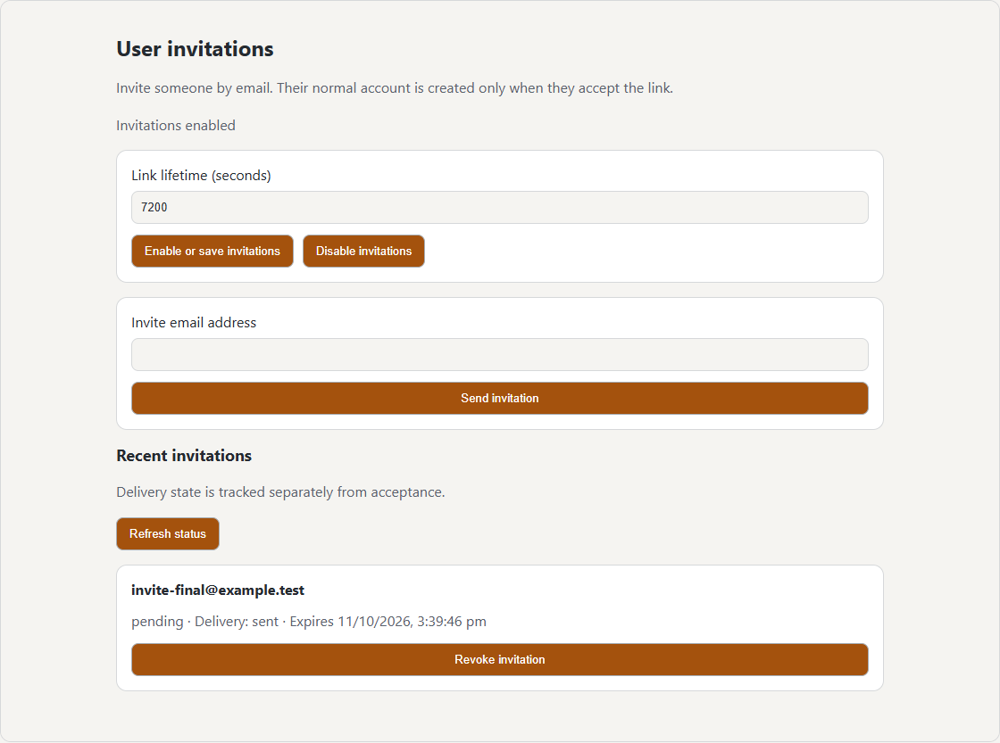
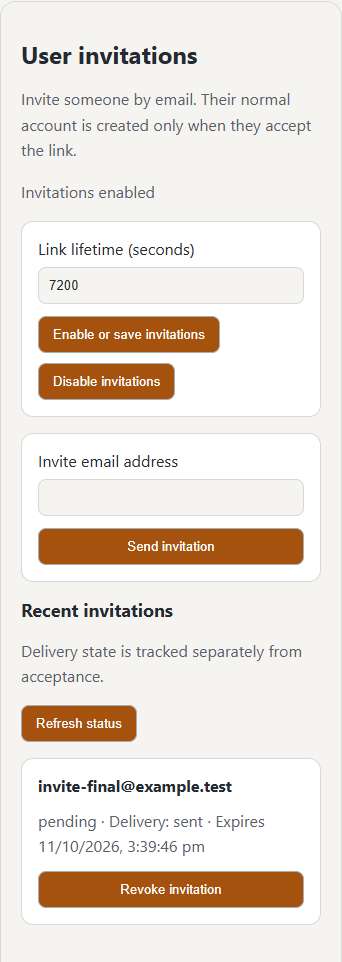

# Maintained user invitations

`official.user-invites` is a working administrator integration, separate from the
synthetic invitation routing demo. It requires Plugin API **1.1.10** and an explicit
critical global `auth.user_invites` grant. The plugin uses the existing gateway and
iframe action bridge; it never imports host source or sends SMTP directly.

## Setup and use

1. Configure built-in SMTP in the host's notification settings. Sensitive delivery
   requires encrypted transport, except development mode or a local literal-IP relay.
2. Install the signed **User Invites** package and approve its declared permissions.
3. Open **Administration → User invitations**, choose a one-hour to seven-day
   lifetime (one day by default), and explicitly enable invitations.
4. Enter an email address and send. The page shows recent delivery/acceptance/expiry
   state and lets the administrator revoke outstanding invitations.
5. The recipient opens the expiring link, chooses username/password on the host
   acceptance page, and signs in normally. Opening the link alone creates no account.

Only acceptance creates a normal account; administrator privileges cannot be supplied.
The host stores and redeems single-use credentials. The plugin receives its own pending
email addresses and status metadata under the critical grant, never invitation bearer
tokens, passwords, SMTP settings, or existing users' destinations.

## Public contract and lifecycle

`auth_flows.user_invites.register` accepts `mode: user_invite`, a name and
`token_lifetime_seconds` (3600–604800). `restore` resumes only a matching already-active
installation. `status`, `issue` (`email`), `list`, `revoke` (`id`) and `unregister`
require the current administrator/global grant and installation authority. The host
reserves the auth event type and supplies anonymous availability/acceptance endpoints;
there is no anonymous plugin execution.

Invites target bounded temporary recipients through a PRIVATE invitation-only SMTP
destination and the core delivery/retry pipeline. They cannot route ordinary messages
or reset credentials, cannot appear in another user's inbox, and do not automatically
verify a new user's personal destination. Canonical content contains no address/token;
the encrypted fragment link is resolved at permitted final handoff. Link origin comes
from configured application URL or the issuer's authenticated last-used URL.

Replacement, revoke, expiry, permission withdrawal, disable, uninstall, and changed
activation invalidate old links and cancel unsent deliveries. Reinstall requires explicit
activation. Issuance is bounded to 100 per administrator and five per email per day,
with 1000 pending records; cleanup retires expired endpoints and removes records after
one additional day. No account auto-login occurs, and marketing unsubscribe headers
are omitted from invitation mail.

See [notification routing](notifications.md) and the
[source and setup](https://github.com/obsoletelabs/unnamed_tracking_app_plugins/tree/main/official/user-invites).

## Administrator controls

These captures show the installed plugin iframe only; host navigation is excluded.

Configure in Administration → Account security → User invitations; launch **Invite user** on Administration → Users to send/review in a dialog. The settings page shows live activation. The host uses responsive HTML mail plus a plain alternative.
