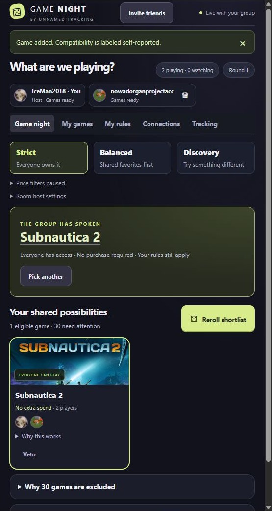
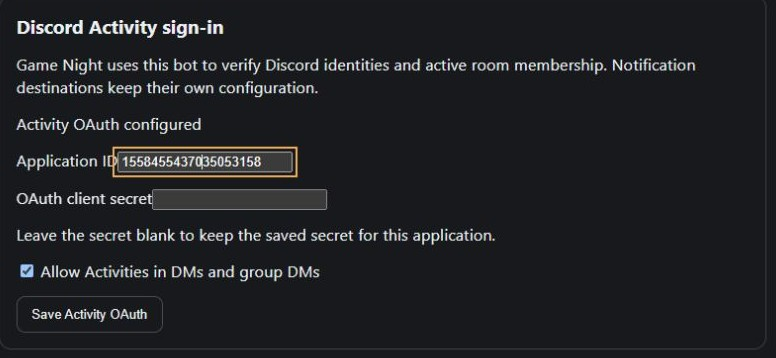
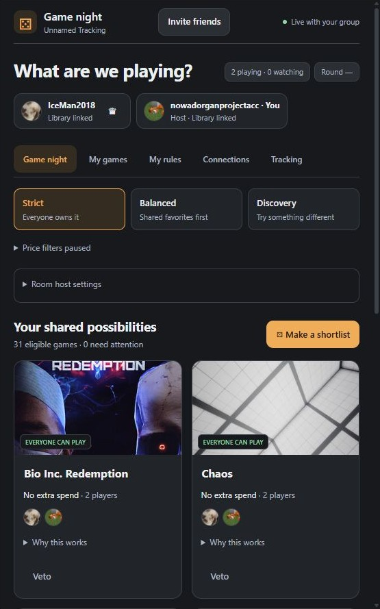
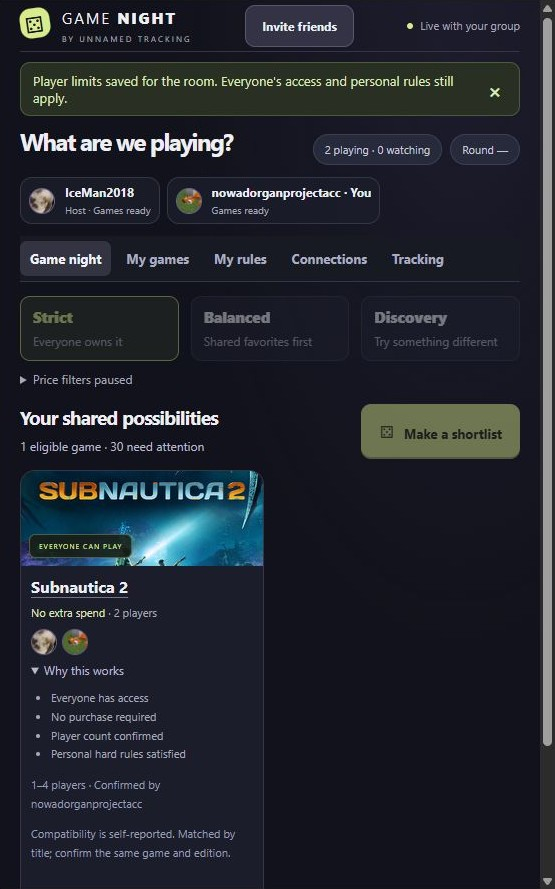

# Set up Game Night and the Discord bot

Game Night helps a Discord group choose something to play from their own
libraries. One person hosts the Activity. Participants can connect different
tracking instances, use an older instance's API key, or add games as guests when
the operator permits it. Only the Activity operator needs to configure a bot.



This is an unsigned development preview requiring the coordinated **Plugin API
1.1.12** host and updated bot adapter. It is not yet a signed catalogue release.
Back up your instance before testing a development host branch. Existing
notification destinations do not need to be recreated for an ordinary update
under the same publisher and installation identity.

## Joining a game night

If someone already hosts Game Night, you do **not** need your own Discord bot.
Launch or join their Activity, open **Connections**, and connect your tracking
instance. Approve the request in that instance's browser window, then return and
refresh your library. You can also add games manually if the operator allows guests.

For one or two players, detected multiplayer is enough when no known limits
conflict. Larger groups can approve games under **Game night → Needs attention**.
Set personal restrictions in **My rules**, then shortlist, vote and choose.
Only operators need sections 1–5 below. Players can start at section 6.

## 1. What the operator needs

- An Unnamed Tracking host with API 1.1.12, working plugin runtime and HTTPS public
  URL. The Activity host can also be one of the source libraries.
- Administrator access to that host and permission to configure a Discord
  application in the [Developer Portal](https://discord.com/developers/applications).
- The matching **Discord Bot Notifications** preview (adapter 0.1.2 or newer) and
  **Game Night** preview packages.
- A Discord test server and the ability to invite the bot. Private applications
  may require participants to be accepted application testers before launching.

For branch testing, download **unsigned-dist** from the plugin repository's
[Plugin checks workflow](https://github.com/obsoletelabs/unnamed_tracking_app_plugins/actions/workflows/ci.yml).
Extract the archive and select the two `.utp` files. Review the source commit and
permissions. Do not use a random package sent by someone you do not trust.

## 2. Create the Discord application and bot

1. In the Developer Portal, create an application or select the application for
   your existing Discord notification bot. Keep the same application for the bot
   and Activity.
2. Copy **Application ID** from General Information. This is public configuration.
3. On **Bot**, create the bot if necessary and obtain its **bot token**. Save it
   securely; Discord may show it only when created/reset. Do not reset an existing
   working token just to inspect it. Server Members Intent is needed for the
   notification dashboard's member discovery, not for reading participants' chat.
4. Under **OAuth2**, obtain the **Client Secret**. This is different from the bot
   token. If it is hidden and you have no saved copy, its reset is a deliberate
   credential change; update the host afterward.
5. Enable **Activities** and the desktop/mobile platforms you intend to test.
6. Enable the installation contexts needed by your deployment. Guild installation
   supports your server; user installation makes the app available in supported
   personal/DM launch surfaces. Follow Discord's current installation controls.
7. Invite the bot to your chosen server with the Developer Portal's installation
   link. Notification delivery needs View Channel, Send Messages and Embed Links
   in its allowed channels. Do not grant Administrator merely for Game Night.
8. Enable Discord Developer Mode, then copy the server's numeric ID from its
   context menu. A channel ID is a different value.

Keep bot tokens and OAuth secrets in the host's write-only settings. They do not
belong in URL mappings, source code, browser query strings or Discord messages.

## 3. Install and configure the two plugins

1. Open **Settings → Administration → Plugins** on the Activity host. Upload the
   updated Discord Bot Notifications package first. Review its signature status,
   permissions and explicit unsigned-preview confirmation.
2. Approve the bot's `integrations.identity_provider` permission along with the
   declared permissions its existing features require. Enable the bot.
3. In **Settings → Administration → Discord Bot Notifications**, enter the bot
   token and server ID, then choose **Validate and save**. A healthy directory
   confirms that the bot and server match.
4. In **Discord Activity sign-in**, enter that application's ID and its OAuth
   client secret. Save them. The status should say **Activity OAuth configured**.
   The adapter checks that the configured bot belongs to this application.
5. Upload the Game Night package, review it and approve `integrations.public_app`
   and `plugin.storage`. Enable it. Its dependency requires the updated bot.
6. In **Settings → Administration → Integration access**, enable integrations.
   Enable hosted guests if people should be able to play without a tracking
   account. Save the policy.

If the runtime reports an isolation problem, use the host's documented runtime
setup and review its diagnostic. Do not add privileged container flags or disable
permission checks to make an Activity launch.

## 4. Point Discord at your HTTPS host

Set the host deployment's public URL to your actual HTTPS origin, for example
`https://tracking.example.com`. This identifies the Activity operator during
source consent. It is not the `discordsays.com` proxy URL.

In **Activities → URL Mappings**, add:

| Prefix | Target |
| --- | --- |
| `/` | `tracking.example.com/api/public-apps/official.discord-social-activity/app/` |
| `/api` | `tracking.example.com/api` |

Use your own domain. The target field may omit `https://` in the Portal UI. Keep
the complete path and trailing slash for the root entry. Save the mappings.

The public Activity page must permit Discord to frame it. The host supplies the
appropriate Content Security Policy. If your reverse proxy adds
`X-Frame-Options: SAMEORIGIN`, exclude only the Activity asset path from that
header. Keep frame protection on the rest of your tracking app.

For Nginx, an operator using a server-wide `add_header X-Frame-Options` can replace
its value with a map in the `http` context:

```nginx
map $uri $tracking_frame_options {
    default "SAMEORIGIN";
    ~^/api/public-apps/official\.discord-social-activity/app/ "";
}
```

In the relevant server configuration, replace the existing frame header with:

```nginx
add_header X-Frame-Options $tracking_frame_options always;
```

Check whether an upstream also sends that header; `proxy_hide_header` removes an
upstream header but cannot remove one added locally by Nginx. Validate your actual
configuration with `nginx -t` before reloading. Do not add a duplicate conflicting
header. Test the public Activity URL: it should return 200 and no blocking frame
header. Opening that URL directly shows the launch page; a real room runs inside
Discord.

## 5. Launch and invite people

Open the configured server's text channel or voice Activity surface, find
the application in Discord's App Launcher and launch it. Accept Discord's private
app test notice if applicable. Discord sign-in identifies the participant and the
bot verifies membership in that exact Activity instance. A tracking account is
not required for a permitted guest.

Participants must join the same Activity instance to share a room. Each person
keeps their own preferences and vetoes. The first active participant becomes the
room host; transferring control requires a separate confirmation. A person with
no game contributions watches without blocking the group by default.

Use **Invite friends** in the Activity header to open Discord's native invitation
dialog. Choose recipients and send from Discord yourself; opening the dialog does
not automatically message anyone. Channel access and private-app tester rules
still apply. If this control is unavailable in a particular Discord surface, use
Discord's own Activity invite/join controls.

Discord currently disables Activity launching in the tested Stage channel: its
launcher shows **You cannot launch an activity here**. Use a text channel, voice
channel or supported DM surface instead; the plugin cannot override Discord's
disabled launch control. Joining a Stage audience does not start an Activity.

### DMs and group DMs

In the bot's **Discord Activity sign-in** settings, enable **Allow Activities in
DMs and group DMs**, then save. Leave the client-secret field blank to keep the
existing saved secret for the same application. This policy is off by default.
It permits private-channel Activity rooms; it does not enable notification DMs or
recovery destinations on anyone's behalf.



Ensure your Discord application permits user installation and the corresponding
private-channel launch contexts. Install it to the testing user's account if
Discord requires that for the launcher. Open the DM/group DM, use its App
Launcher or supported Activity/call launch control, and have the other person
join that same instance. Private applications can still require accepted tester
access. An app hidden by Discord's installation/testing settings will not appear
merely because the host checkbox is enabled.

For an application created with guild-only launch settings, inspect its `launch`
entry point with Discord's [Application Commands API](https://docs.discord.com/developers/interactions/application-commands).
DM launches need user installation (`integration_types` includes `1`) and private
channel context (`contexts` includes `2`). Supporting both guild and private
launches normally uses `integration_types: [0, 1]` and `contexts: [0, 1, 2]`.
Installation contexts alone do not override a command's narrower contexts.

The bot verifies Discord's private-channel location and exact connected member
list. A DM does not need a guild ID. Server rooms remain restricted to the
configured guild even while DM support is enabled. Separate Activity instance IDs
keep server and private rooms separate; connecting a library in one does not
publish its credentials in another. The operator still uses the configured bot
application and its saved OAuth credentials.

## 6. Connect a current tracking instance

The source instance's administrator first enables Integration access and allows
the Activity host's exact HTTPS origin. They may instead explicitly allow consent
requests from any HTTPS origin; individually disabled origins remain blocked.
Approving an origin only lets it request access. Each person must approve their
own account data.

In Game Night's **Connections** tab, enter the source instance's HTTPS origin.
Library matching requests only identity and game reads. Select **Request optional
tracking and achievement access** only if you want the progress features too.
That adds achievement reads and optional tracking/achievement writes; it does not
request your media, custom lists or field history.
Open the returned consent page in your normal browser and sign in to that source.
Verify the requester name, source instance and requested capabilities. Writes are
optional and initially unchecked. Choose timed access or explicitly choose
**Until revoked**, then approve or deny. Return to the Activity; it polls the
pending request and offers refresh when connected.

A Discord display name cannot silently link a tracking account. After first
consent, the verified Discord identity can reuse its still-valid remembered source
connections on reconnect. Check **Account → Connected apps** on the source to
review scopes, remove capabilities or revoke access. Removing an origin or
disabling integrations blocks its grants too.

## 7. Connect an older tracking instance

If the source cannot be upgraded, the Activity operator can enable **Allow unsafe
legacy API-key connections** in Integration access and save the policy. The
participant selects legacy mode in Connections, enters the old source's HTTPS
origin and an API key created on that source, and acknowledges the broad key.

Legacy keys may have much broader account authority than the Activity needs.
The host encrypts the key, uses only identity/library reads and never returns it
to plugin code. Legacy connections cannot update tracking, achievements or saved multiplayer settings.
Imported artwork may be unavailable; public Steam cover fallback is separate.
Disconnect to remove the broker copy and revoke the key on the old source when
finished. The old instance does not need a new plugin runtime for this read mode.

## 8. Choose games and keep control of your rules

Owned games detected as multiplayer are included automatically after library
refresh. **My games** defaults to owned multiplayer entries; untick its filters
to browse the rest of your library. Detection uses available features/tags and
saved multiplayer markers. It is an inference, not provider verification.

For **one or two active players**, detected multiplayer is valid without entering
exact limits. For larger groups, open **Game night → Needs attention** and choose
**Approve for N players**, or select several games and approve them together.
One person can approve for the current group without supplying extra metadata.
That approval must be renewed if the number of players changes. Known saved or
manually reported limits remain authoritative and cannot be bypassed by approval.



Choose **Set known player limits** to enter a reusable minimum and maximum once
for the room. Common ranges are available as buttons. These room details survive
reconnects until room retention expiry; they do not write anyone's source library.
If your platform is missing, the form asks only for your own platform. A valid
Steam app ID infers **PC** when the platform is blank; an explicit platform wins.
The host can disable small-group acceptance or Steam inference in room settings.
Steam inference does not prove Windows/Mac/Linux support or crossplay.

Ownership, platform, crossplay, session length, personal rules and vetoes still
apply independently. People without games spectate without blocking by default.
Guest ownership, room approvals and manually entered compatibility are self-reported.

### Save multiplayer details in the tracking app

On a game's **Overview**, choose **Edit multiplayer settings**. Tick **Playable
with others** and save without extra data, or enable known limits and set both
minimum and maximum. Duration and crossplay are optional. You can also use the
ordinary game's Edit form. To update several games in one instance, select them
in the library, open **Bulk Edit**, opt into **Apply multiplayer settings**, and
review the replacement. Unchecked fields are untouched; leaving the playable
marker unchecked explicitly clears saved multiplayer details.

### Save selected games across linked instances

In **Connections**, select **Request optional multiplayer settings access** and
connect/reconnect each current source. Approve **Save your games' multiplayer
settings** on its consent page. Existing grants never gain this permission
automatically. It is separate from progress access and uses `compatibility.write`.

In **My games**, select entries across pages and instances (up to 100). Choose
**Edit selected multiplayer settings**, set a preset or clear it, expand the
target review, and confirm the selected game records. A preset replaces those
games' multiplayer details only. All selected sources must be connected and
grant the new scope. Legacy keys remain read-only. Each game saves independently;
the results list reports successes and source failures. Refresh the affected
connections afterward. A failed source does not roll back successful saves.



**My rules** controls your platform, genres, time and ownership/purchase consent.
The host chooses Strict, Balanced or Discovery and can change room matching
defaults. Normalized titles tolerate case, spacing and punctuation; edition or
crossplay differences still need confirmation. Current purchase offers are
unavailable, so price/budget/discount filtering is paused and unknown prices are
never called free.

Make a shortlist, vote and choose together. **Veto** removes a game under your own
rules; **Undo veto** restores it without clearing anyone else's veto. Click a
title for public information, a Steam link and your own tracking-page link when
available. Public images do not grant access to another person's source instance.

## 9. Optional tracking and achievement updates

Select optional progress access in Connections, then connect through scoped
consent and approve the relevant writes on your source. An existing read-only
connection needs a new consent request to add these capabilities.
In **Tracking**, choose your connection and game, review the proposed change and
confirm it. Read-only or legacy connections cannot perform these actions. A local
edit to a synced achievement is explicitly self-reported and stored separately
from provider evidence. It is not a Steam unlock or provider verification.
Changing the connection or game clears the approval checkbox. A status update
preserves the completion date unless you select **Change completion date**;
leaving the date blank after selecting that option explicitly clears it. Manual
self-reports appear separately. This preview shows the first achievement page;
use your tracking app to inspect further pages.

## Troubleshooting

| Symptom | Check |
| --- | --- |
| `discordsays.com refused to connect` | Root mapping, HTTPS reachability, frame headers and Content Security Policy |
| OAuth not configured / sign-in failed | Same application ID/bot, OAuth client secret rather than bot token, latest bot package, then relaunch |
| Room membership could not be verified | Join this exact instance; confirm configured server or permitted private-channel location |
| Legacy connections disabled | Activity host's Integration access policy, then Save instance policy |
| Owner must approve an origin | Approve the Activity host's actual HTTPS origin on the source, or enable its optional open requester policy |
| Connected but no eligible games | Expand Needs attention; check ownership, group approval, hard rules, source state and other participants' vetoes |
| Bulk multiplayer Save disabled | Every selected source must grant compatibility.write; reconnect with multiplayer settings access and approve it |
| Images unavailable | Public metadata may be absent or ambiguous; imported legacy artwork is not supported; readable fallback remains |
| Source offline/revoked | Check the source's reachability and Connected apps grant/key, then refresh or reconnect |
| Old UI after an update | Leave/reload/relaunch Discord so it fetches the versioned frontend assets |
| Bot looks offline | HTTP notification delivery and Activity identity do not require persistent Gateway presence |

For operators, read the [installation guide](../lifecycle/install.md) and
[runtime troubleshooting](../troubleshooting/index.md). Discord's official
[Activity guide](https://docs.discord.com/developers/activities/overview) describes
current app visibility/testing requirements; launch availability depends on your
Discord application settings as well as the installed plugin.

See the [implementation and acceptance matrix](../architecture/discord-game-night.md) for the repository boundaries, current issue coverage and remaining release checks.
