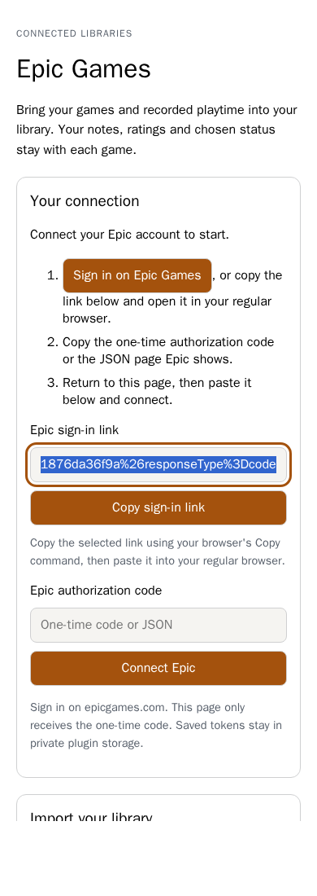
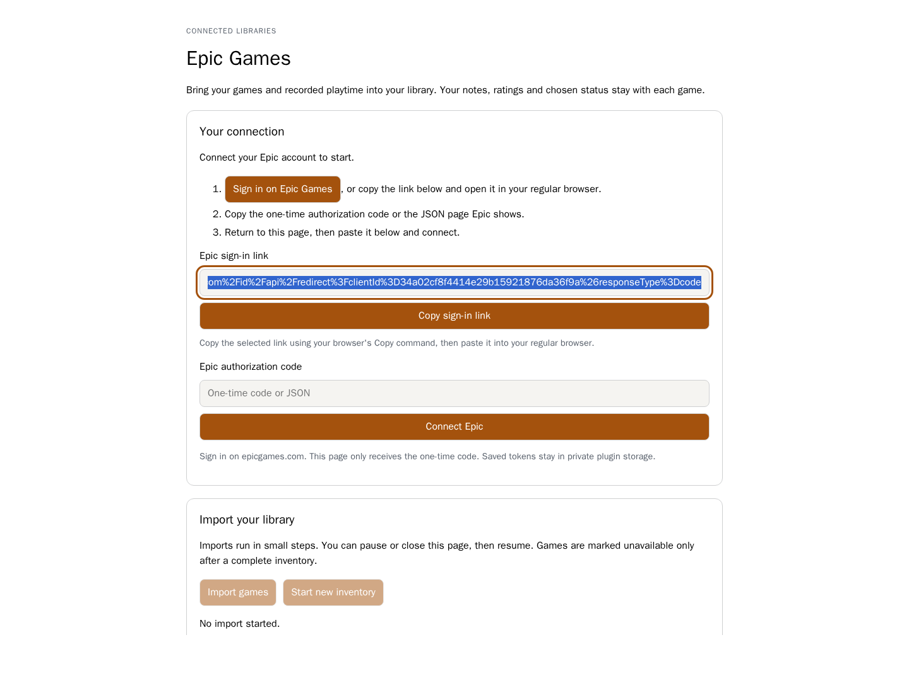
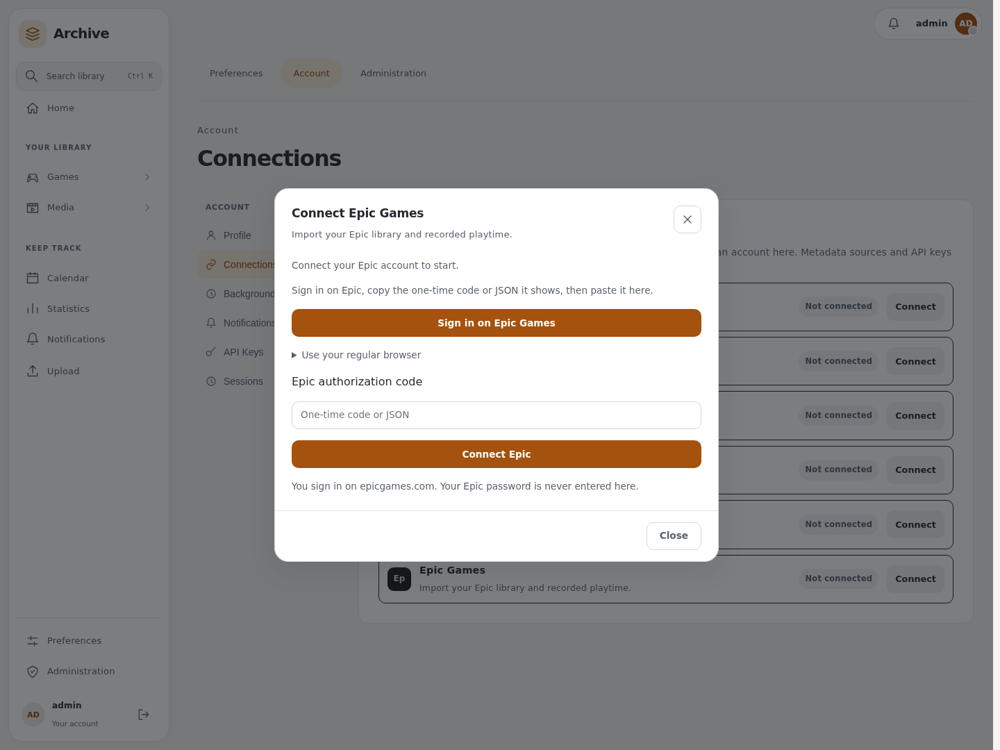
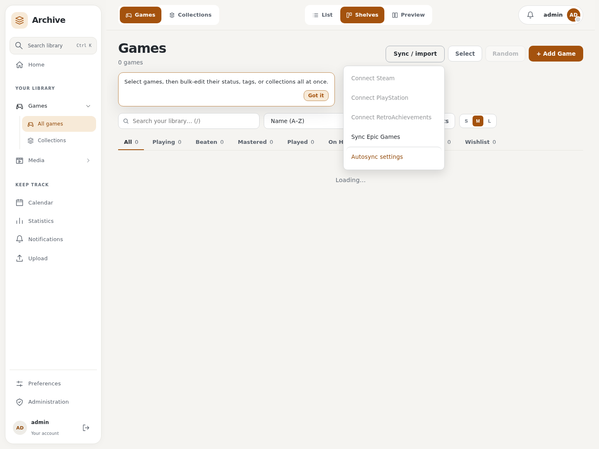
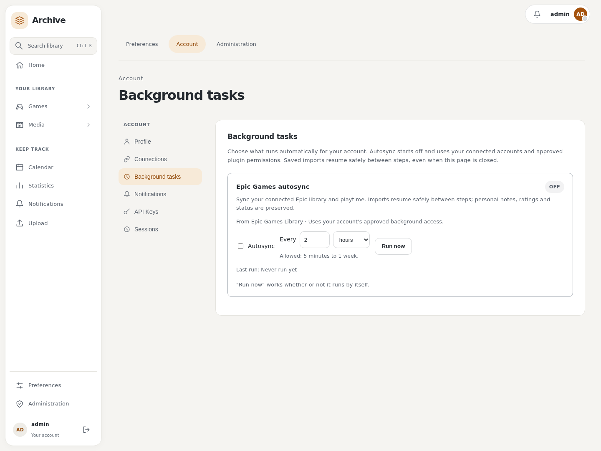

# Epic Games Library

The official `official.epic-games` plugin keeps Epic connection and import behavior
outside the core app. It requires the host's additive **Plugin API 1.1.19**
(`games.import` artwork addresses on top of the 1.1.11 connection sync and personal schedule contracts). Its sandboxed page offers personal sign-in, imports,
pause/resume and disconnect through declared actions.

## Experimental service dependency

!!! warning "Unofficial Epic services"
    Epic does not publish or support an API for third-party library imports, and
    this plugin is not affiliated with or endorsed by Epic Games. It does not use
    Epic Online Services or an Epic-issued OAuth client. It signs in with the
    Epic Games Launcher's public client through Epic's own sign-in page, then
    reads the launcher's undocumented account, library, playtime and catalogue
    services. Epic can change, rate-limit or withdraw those services at any time,
    so sign-in, imports or playtime may stop working until a new plugin release
    adapts.

An Epic service failure is not host data loss. A failed sign-in, refresh or
provider request keeps the saved connection, checkpoint and library; the plugin
never deletes games, and disconnecting keeps imported games. Imports carry the
title, Epic identity, and (when Epic supplies them) description, developer,
publisher, total playtime and, for games that lack those pictures, the addresses of
Epic's key art, banner, logo and icon (the host downloads them). Release dates,
genres/tags and achievements are not imported.

The plugin README is the maintained reference for
[imported fields](https://github.com/obsoletelabs/unnamed_tracking_app_plugins/blob/main/official/epic-games/README.md#imported-fields)
and
[troubleshooting and support](https://github.com/obsoletelabs/unnamed_tracking_app_plugins/blob/main/official/epic-games/README.md#troubleshooting-and-support),
including the plugin's error messages, reconnection with **Replace sign-in** and
where to report problems.

Sign in on Epic's own site and submit its one-time code. Use **Copy sign-in link**
to open Epic in your regular browser while leaving the app open; if clipboard
access is unavailable, copy the selected link manually. The plugin retains
rotating tokens in private per-user storage and saves the replacement refresh
token before later requests. Runtime storage is isolated by filesystem permissions
and is not encrypted at rest. Protect deployment data and backups.

The access-token lifetime must be a positive finite number. A provider lifetime
longer than one day is accepted, while local refresh still occurs at the shorter
of the provider lifetime and one day. Invalid lifetimes keep the previous
connection rather than replacing it.

The regular-browser option leaves this page open. These screenshots exercise the
packaged frontend's opaque sandbox with a status/action fixture; they do not
claim a successful live account connection.

Each action performs bounded work: one inventory page, optional playtime, one
catalogue namespace batch or a host import of at most 25 games. The saved checkpoint
survives errors and page closure. Namespace/catalogue identities are scoped to
the connected account and host actor; manual status, notes, ratings and field
locks remain under the host's import policy. Complete valid inventory is required
before marking missing games unavailable. Games are never deleted by the plugin.

Epic Games is listed on **Settings > Account > Connections** through the
`connections` contribution, whose `status` action reports whether the account is
connected. **Connect** and **Manage** open the page above in a popup, so there is
no sidebar entry. Permissions are `games.write`, `network.outbound`,
`plugin.storage`, `frontend.connections` and `tasks.background`. There are no host source imports,
direct database connections or native frontend permission. Automatic sync starts off.

The popup uses Steam's host dialog width and shared appearance, with import controls
shown after connection. Games → Sync / import exposes **Sync Epic Games** through
the declared connection sync action. Account → Background tasks offers an independent
personal autosync schedule. It advances bounded saved steps and resumes incomplete
work after one minute while enabled, then returns to the chosen interval. The same
actor-scoped lease protects foreground and scheduled imports from overlap.

The following captures show version 0.7.0 installed in a disposable host. The
connection view uses a local provider HTTP fixture; it does not claim live Epic
sign-in.

See the [plugin README](https://github.com/obsoletelabs/unnamed_tracking_app_plugins/blob/main/official/epic-games/README.md)
for build/install instructions, limitations and protocol references. Branch CI
supplies an unsigned `.utp` preview; signed publication uses the existing protected
official pipeline. Live-account validation requires signing in on Epic itself;
provider fixtures alone do not establish live service success.

Regression coverage is in `tests/test_epic_games.py`, including malformed paging,
rotating tokens, namespace collisions, DLC filtering, optional playtime,
permission denial and replay after a host commit/checkpoint failure. Browser and
actual packaged runtime/database evidence are linked in the implementation PR.

See [installed-package validation](epic-games-validation.md) for the repeatable
checks, provider-fixture boundaries and limitations.
